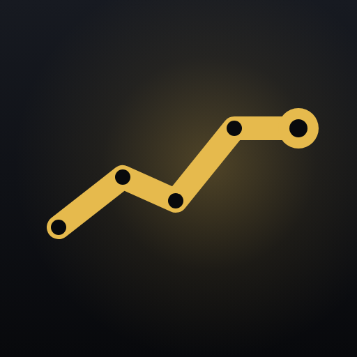

# Qima brand guidelines

Version 1.0 (draft for owner sign-off), October 2026. Written from the app as it ships in 3.0.0 plus the v3.1 design pass on `v3.1/design-polish`.

Companion files:

| File | What it holds |
|---|---|
| [`discovery.md`](discovery.md) | Phase 1 findings these guidelines are built on |
| [`tokens.json`](tokens.json), [`tokens.css`](tokens.css), [`flutter/qima_tokens.dart`](flutter/qima_tokens.dart) | Every colour, type step, space, radius, shadow and motion value, light and dark |
| [`contrast.md`](contrast.md) | Measured contrast ratio for every recommended pair |
| [`assets/`](assets/) | Wordmark, lockup and icon exports, SVG and PNG |
| [`changes.md`](changes.md) | What differs from the app today, and which files would change |
| [`open-questions.md`](open-questions.md) | What is still undecided, and every assumption made |
| [`tool/build_brand.py`](tool/build_brand.py) | Regenerates tokens, contrast tables and assets; fails if any pair misses contrast |

How to read the evidence column: a path is a file in this repository, a key such as `zakatDisclaimer` is a string in `lib/l10n/app_en.arb`, and "screenshot" means a file under `ios/fastlane/screenshots/`, which the app's own integration test generates.

---

## 1. Brand core

### Purpose

Help people who hold gold, and everything else they own, see what it is worth in the units and currency they actually think in, without handing their data to anyone.

### Positioning

> For people who keep part of their wealth in gold, Qima is the private portfolio tracker that starts with metals: prices by gram, ounce or kilogram and by karat, everything else they own added to the same total, and zakat worked out from it, with no account and nothing stored on our servers.

Gold-first is a decision (owner answer 1). Metals lead every listing, screenshot set and hero; crypto, stocks, indices and currencies follow as "and everything else you own".

### Audience

| | Who | Evidence it fits the product |
|---|---|---|
| Primary | Arab and Gulf households and individuals who hold physical gold (bars, coins, jewellery) and want its value in their own currency and karat | Karat pricing "the way Gulf and Middle-East jewellery markets quote it" (`README.md`); 8 of 11 built-in currencies are Gulf, Levant or Egypt (`lib/models/instrument_catalog.dart`); zakat module; Saudi Riyal glyph font |
| Secondary | People anywhere who hold metals alongside crypto, stocks and cash and want one private total | 160+ display currencies; English, Spanish, French |

### Personality

| Trait | This | Not that | In the product |
|---|---|---|---|
| Precise | Names the unit, the karat, the date | Vague, rounded, "about" | "Live prices by gram, ounce or kilogram, 24K to 18K" (`onboardingStep2Body`) |
| Calm | States what happened and what to do | Alarm, urgency, exclamation marks | "Couldn't refresh prices. Check your connection and try again." (`errorRefreshFailed`) |
| Private | Says plainly where data lives | Hand-waving ("secure", "bank-grade") | "No account. Your data stays on this device..." (`onboardingStep5Body`) |
| Respectful | Defers on faith and money decisions | Telling people what to do | "Qima computes; it does not rule." (`zakatDisclaimer`) |
| Plain | Short words, short sentences | Jargon, hype, cleverness | "Every asset you hold. One number." (`site/index.html`) |

### Tagline

**Every asset you hold. One number.** (Owner answer 11: keep.) Source: `site/index.html` hero; the same idea opens onboarding ("Everything you own, in one number", `onboardingStep1Title`).

| Language | Tagline | Note |
|---|---|---|
| English | Every asset you hold. One number. | |
| Arabic | كل ما تملكه في رقم واحد | Already shipped as `onboardingStep1Title` (ar) |
| Spanish | Todo lo que tienes, en un número | Already shipped as `onboardingStep1Title` (es) |
| French | Tout ce que vous possédez, en un chiffre | Already shipped as `onboardingStep1Title` (fr) |

### Claims rules

Qima may only say what the app does today. Every public claim must appear in this table, with its source, before it is used.

| Claim (may say) | Source in the app |
|---|---|
| Prices for gold, silver, platinum and palladium per troy ounce, gram or kilogram | `lib/models/asset.dart:68` `PriceUnit` |
| Gold by 24K, 22K, 21K and 18K | `karatShort24`...`karatShort18`; store description |
| Live prices, with the delay disclaimer nearby (owner answer 12) | `onboardingStep2Body`; disclaimer in `ios/fastlane/metadata/en-US/description.txt` |
| Bitcoin and Ethereum; major stocks and indices; world currencies | `lib/models/instrument_catalog.dart` (stocks and indices: see pending row) |
| Add any stock or ETF ticker not built in, checked against the price source | `addCustomTickerTitle`, `README.md` "Custom tickers" |
| Record buys, sells, transfers and fees; see value, cost, average cost and gain | `onboardingStep3Body`; 3.0.0 release notes |
| Portfolio allocation by class, gold by karat, drift since January | `allocationMetalsByForm`, `allocationDriftSince`; release notes |
| Zakat: nisab on 85 g gold or 595 g silver, what counts, hawl on Hijri or Gregorian calendar, reminder | `helpZakatStep1Body`, `zakatCalendarHijri`, `zakatRemind` |
| Price alerts: above, below, or a % move in 24 hours or 7 days | `alertKind*`, `alertWindow*` |
| Charts from one day to all time | `README.md` "Charts"; range keys `range1D`...`rangeAll` |
| No account, no sign-up, no login | `onboardingStep5PillNoAccount`; store description |
| No ads, no analytics, no tracking | `README.md` "Privacy"; store description |
| Data stays on your device, with optional iCloud sync on Apple devices | `onboardingStep5Body`, `lib/services/icloud_kv_store.dart` |
| App lock with Face ID, Touch ID, fingerprint or passcode; hide balances | `settingsAppLockFooter`, `privacyHideBalances` |
| Backups you can protect with a password, encrypted with AES-256 (owner answer 13) | `backupExportSheetProtectSubtitle` |
| Import and export holdings as a spreadsheet (CSV) | `backupExportCsvSubtitle`; release notes |
| English, Arabic, Spanish and French, with full right-to-left Arabic | `l10n.yaml`, store description |
| Free, with no subscription and no in-app purchases, stated as current fact (owner answer 18) | store description |
| Price and portfolio widgets on the iPhone Home Screen and Lock Screen, and on the Android home screen (owner answer 17: shipped since 2.0.0) | `ios/QimaWidget` (system and accessory families), `android/app/src/main/AndroidManifest.xml` `PriceGlanceReceiver`, `PortfolioGlanceReceiver` |

| Claim | Status | Why |
|---|---|---|
| Stock and index prices as a headline | Do not claim (owner answer 14) | Prices are scraped from Yahoo Finance; no licensed feed is planned. Stocks and indices may appear in a list beside metals, never in a title, subtitle, headline or promotional text |
| Wear OS | Do not claim (owner answer 15) | No Wear module: `android/settings.gradle.kts` includes only `:app` |
| Tolas | Do not claim (owner answer 16) | No tola unit in `PriceUnit` |

Never say:

- Anything about returns, profits, "grow your wealth", or which asset to buy. Qima is not advice (store disclaimer).
- "Real-time", "exchange-grade", "bank-grade security", "military-grade encryption". Say "AES-256" and stop.
- "Certified", "audited", "trusted by", user counts, ratings, testimonials or partner names. None exist.
- That Qima issues religious rulings. It "computes; it does not rule" (`zakatDisclaimer`).
- "Your data never leaves your phone" when iCloud sync is on. Say "stays on your devices".
- That data is deleted when you uninstall (not true with iCloud sync).

Required near any price or zakat claim in marketing: "Prices come from third-party sources and may be delayed. Qima is not investment advice." For zakat: "Qima calculates; the choices behind the calculation are yours." (`helpZakatSummary`).

---

## 2. Name and logo

### The name

| Item | Rule |
|---|---|
| Spelling | **Qima**: capital Q, lower-case i-m-a, one word |
| Meaning | From Arabic قيمة (qīma), "value" or "worth" (`README.md` line 3) |
| Pronunciation | KEE-mah. In Arabic the q is a uvular /q/, said further back than k: /ˈqiː.ma/. English speakers may say /ˈkiː.mə/; both are fine. |
| Grammar | No article ("open Qima", not "open the Qima"). In Arabic the app takes masculine agreement, referring to التطبيق: "Qima مقفل", "Qima يحسب", as shipped. |
| Possessive | Allowed in English marketing ("Qima's zakat screen"); avoid in UI strings. |

One rule for every language and context:

> Write **Qima** in Latin letters, in every language, everywhere the name sits inside a sentence. Write **قيمة** only where the name stands alone as a title for Arabic readers: the Arabic store title, the home-screen label on Arabic devices, the app's title bar in Arabic, and the Arabic wordmark.

Why: قيمة is also the everyday Arabic word the app uses for "value" (`holdingsValue` القيمة, `portfolioValue` القيمة الإجمالية). Inside a sentence it would read as "the value", not the app. As a standalone title it reads as the name, and it is what Arabic users will search for.

| Context | Correct | Wrong |
|---|---|---|
| English sentence | Unlock Qima to see your portfolio | Unlock QIMA / qima / the Qima app |
| Arabic sentence | افتح قفل Qima لرؤية محفظتك (`appLockAuthReason`) | افتح قفل قيمة لرؤية محفظتك |
| Arabic store title | قيمة: الذهب والمحفظة | Qima: الذهب والمحفظة |
| Arabic home-screen label | قيمة | Qima |
| French store title | Qima : Or et Portefeuille (no-break space before the colon) | Qima: Or et Portefeuille |
| All-caps styles (overlines) | Keep the name out of all-caps text, or exempt it | QIMA |
| Transliteration | Qima | Qeema, Qimah, Kima, Qīma |
| Translation | Qima | Value, Valor, Valeur |

Store title pattern: `Qima: <what it is>` in each language, as shipped (`name.txt`, `title.txt`).

### Logo system

Qima has two marks: the **app icon** (the primary mark, used wherever there is room for only one thing) and the **wordmark**. The **lockup** combines them. Nothing here is a custom drawing: the wordmark is set in a font the app already ships, and the app icon stays as shipped (owner answers 7 and 22).

#### Wordmark

| Item | Value |
|---|---|
| Typeface | **Almarai Bold (700)**, SIL OFL 1.1, already bundled at `assets/fonts/almarai/Almarai-Bold.ttf` |
| Letter spacing | −0.01 em (−10 units at 1000 units per em) |
| Arabic wordmark | قيمة in Almarai Bold, no letter spacing (spacing breaks Arabic joins) |
| Form | Outlined paths, never live text, so it renders the same everywhere |
| Files | `assets/logo/qima-wordmark-*.svg` and `assets/logo/png/*-256w.png`, `-512w.png`, `-1024w.png` |

Why Almarai: it is already in the app for Arabic, its Latin was drawn to sit beside its Arabic, and it keeps both wordmarks in one family with no new licence.

#### Construction and clear space

- Unit **C** = the cap height of the Q in the wordmark (716 units).
- Clear space on every side of the wordmark or lockup: **0.5 C**. Nothing else (text, edges, other logos) enters it.
- Lockup: icon height **1.4 C**, gap between icon and wordmark **0.4 C**, wordmark cap height centred on the icon. Files: `assets/logo/qima-lockup-on-light.svg`, `qima-lockup-on-dark.svg`.
- The lockup icon is the shipped app icon (`assets/icon/app_icon.png`, owner answers 22 and 25), clipped to the rounded square. On dark it gets a 1 px hairline edge so the icon's border reads.

#### Minimum sizes

| Mark | Digital | Print |
|---|---|---|
| Wordmark | 64 px wide | 15 mm wide |
| Lockup | 96 px wide | 25 mm wide |
| App icon, full artwork | 64 px | 12 mm |
| App icon, small artwork (`qima-app-icon-small.svg`) | 16 to 48 px | under 12 mm |

#### Colour versions

| Version | Use | File |
|---|---|---|
| Ink on light (`#111318`) | Default on light backgrounds | `qima-wordmark-on-light.svg` |
| White on dark | Default on dark backgrounds | `qima-wordmark-on-dark.svg` |
| Gold on dark (`#E6BA4D`) | Brand moments on dark: store art, website hero | `qima-wordmark-gold-on-dark.svg` |
| Gold on light (`#8A6410`) | Rarely; brand moments on light | `qima-wordmark-gold-on-light.svg` |
| Single colour black | Print, fax, engraving, one-colour jobs | `qima-wordmark-black.svg` |
| Single colour white | Knock-out on photos or solid colours | `qima-wordmark-white.svg` |
| Arabic, on light and dark | Arabic-only layouts | `qima-wordmark-ar-on-light.svg`, `-on-dark.svg` |

Never set the wordmark in bright `brand` gold (`#D4A72C`) on a light background: 2.24:1 on white.

#### App icon

**Decision (owner answer 22): the stores keep the current icon**, `assets/icon/app_icon.png`, as shipped in 3.0.0. Nothing below changes the app or the store listings. The refined artwork stays in `assets/icon/` as a proposal for a later version.

The refined proposal keeps the shipped idea: a gold line through dark nodes on a near-black field with a warm glow. Its changes:

1. The arrowhead is gone. The last segment runs level and ends in a larger node, so the mark says "value, tracked" rather than "always up". An arrow that only rises reads as a promise of gains, which the claims rules forbid.
2. The vertical light shafts are removed; one radial glow remains.
3. Node and stroke sizes are fixed (stroke 68, inner node 22, end node 58 with a 26 hole, on a 1024 grid) and a separate small artwork exists for 48 px and below.

| Rule | Value |
|---|---|
| Master | 1024 × 1024, no alpha (`assets/icon/png/qima-app-icon-1024.png`) |
| Background | Gradient `#171A21` to `#08090C`; glow `#E6BA4D` at 30% fading to 0 |
| Line and end node | `#E6BA4D` (brand gold, dark) |
| Nodes | `#08090C` |
| iOS 18 dark appearance | `assets/icon/png/ios-dark-1024.png` (transparent background) |
| iOS 18 tinted appearance | `assets/icon/png/ios-tinted-1024.png` (greyscale) |
| Android adaptive | Foreground `android-adaptive-foreground-432.png` inside the 66 dp safe zone; background `#0B0C10` (unchanged from `pubspec.yaml`) |
| Android 13+ themed | `android-adaptive-monochrome-432.png` |
| macOS, Windows | Build with `tool/macos_icon.py` from the new master, as today |
| Mark on light (documents, not the app icon) | `assets/icon/qima-mark-on-light.svg` |

The table describes the refined proposal. Until it is adopted, use the shipped icon wherever the app icon appears (store art, website, social), and do not swap the store icon.

#### Misuse

| Don't | Why |
|---|---|
| Re-type "Qima" in another font, or in the platform font, and call it the logo | The website does this today (`site/index.html:23`); use the outlined wordmark |
| Stretch, skew, rotate, outline, add shadows or gradients to the wordmark | It breaks the letterforms |
| Add coins, bars, sparkles or extra arrows to the icon | Implies gains; adds noise at small sizes |
| Recolour the icon line (green, red, other accents) | Green and red mean up and down inside the app |
| Set the wordmark in all caps or add letter spacing in Arabic | Wrong name casing; breaks Arabic joins |
| Use the full icon artwork below 48 px | Nodes fill in; use the small artwork |
| Place the dark lockup on a dark photo without the hairline edge | The icon disappears |
| Combine the wordmark with "app", a tagline or a publisher name inside the clear space | Publisher appears in footers only (owner answer 20) |

---

## 3. Colour

Two rules hold the palette together:

1. **Gold is the brand, used sparingly.** One solid-gold element per screen at most: the primary action. Everything else that is "selected" uses a soft gold wash with a gold border.
2. **Green and red mean up and down**, never decoration.

All values below are in `tokens.json`. Ratios are measured by `tool/build_brand.py`; the full tables are in [`contrast.md`](contrast.md).

### Core palette

| Token | Dark | Light | Role |
|---|---|---|---|
| `brand` | `#E6BA4D` | `#D4A72C` | Gold fill: the primary button, switch track on iOS, brand art. Never text. |
| `brandText` | `#E6BA4D` | `#8A6410` | Gold text and icons: text buttons, links, selected tab |
| `brandIndicator` (new) | `#E6BA4D` | `#A87B14` | Gold marks that must reach 3:1: selected-chip border, Material switch track, focus ring |
| `onBrand` | `#08090C` | `#1A1406` | Text on a gold fill |
| `bg0` / `bg1` | `#08090C` / `#0F1116` | `#ECEEF2` / `#F7F8FA` | Screen background gradient |
| `surfaceTop` / `surfaceBottom` | `#1F2229` / `#191B21` | `#FFFFFF` / `#FAFAFC` | Card gradient |
| `tileTop` / `tileBottom` | `#2B2F39` / `#22252D` | `#F2F3F6` / `#EAECF0` | Inset tile, chip and segment track |
| `segmentThumb` | `#454A56` | `#FFFFFF` | Selected segment |
| `overlay` | `#262A33` | `#FFFFFF` | Menus, dialogs, sheets |
| `textPrimary` | `#FFFFFF` | `#111318` | Text, figures |
| `textSecondary` (changed) | white 68% | `#111318` 76% | Supporting text |
| `textTertiary` | white 52% | `#111318` 60% | Captions, timestamps, unselected tabs |
| `hairline` / `hairlineStrong` | white 10% / 18% | `#111318` 10% / 18% | Decorative borders and dividers |
| `shadow` / `scrim` | black 45% / 55% | `#1B2230` 8% / `#111318` 32% | Card shadow, modal scrim |

### Semantic colours

| Token | Dark | Light | Role | Always with |
|---|---|---|---|---|
| `up` | `#3DBE6E` | `#166B2E` | Price or value rose | An up arrow or a + sign |
| `down` | `#FF6B61` | `#B42A26` | Price or value fell | A down arrow or a − sign |
| `success` | `#3DBE6E` | `#166B2E` | Saved, restored, done | A check icon |
| `warning` (new) | `#F5A524` | `#9A4D00` | Needs attention, not broken (backup overdue, notifications off) | `warning_amber` icon |
| `error` | `#FF6B61` | `#B42A26` | Failed or invalid | `error_outline` icon |
| `info` (new) | `#6EA8FF` | `#1F62C9` | Neutral notices | `info_outline` icon |

Colour is never the only signal. The app already pairs trend colour with an arrow in rows (screenshot `en-US/iphone_1_watchlist`); keep doing that everywhere.

### Instrument accents

Used only as icon tints and allocation segments, never as text.

| Token | Dark | Light (changed values marked) |
|---|---|---|
| `accentGold` | `#E6BA4D` | `#A87B14` (changed, equals `brandIndicator`) |
| `accentSilver` | `#C7C7C7` 78% | `#7A7D83` (changed) |
| `accentPlatinum` | `#A9C4DD` | `#5A7FA5` (changed) |
| `accentCrypto` | `#F28C33` | `#C2620F` (changed) |
| `accentFiat` | `#3FB8C9` | `#10808F` (changed) |
| `accentStock` | `#6B8CEB` | `#4A6FDB` |
| `accentIndex` | `#9975E0` | `#7447C9` |

### Measured contrast

Text tokens, lowest ratio across `bg0`, `bg1`, `surfaceTop`, `surfaceBottom`, `tileTop` and `overlay` (needs 4.5:1):

| Text token | Dark (lowest) | Light (lowest) |
|---|---:|---:|
| textPrimary | 13.39 | 16.00 |
| textSecondary | 7.06 | 7.89 |
| textTertiary | 4.81 | 4.60 |
| brandText | 7.33 | 4.62 |
| up / success | 5.60 | 5.69 |
| down / error | 4.80 | 5.48 |
| warning | 6.56 | 5.26 |
| info | 5.55 | 4.95 |
| onBrand on brand | 10.90 | 8.17 |

UI marks, lowest across `bg0`, `surfaceTop`, `tileTop` (needs 3:1):

| Token | Dark | Light |
|---|---:|---:|
| brandIndicator / accentGold | 7.33 | 3.28 |
| accentSilver | 5.50 | 3.55 |
| accentPlatinum | 7.41 | 3.61 |
| accentCrypto | 5.47 | 3.58 |
| accentFiat | 5.68 | 4.01 |
| accentStock | 4.19 | 3.94 |
| accentIndex | 3.81 | 5.18 |

Component pairs: `textPrimary` on the selected-chip wash is 10.78 (dark) and 15.51 (light) over a card; on `segmentThumb` 8.87 and 18.58.

Recorded but not used as an indicator: `brand` fill against a light card is 2.24:1. It is allowed only on a labelled button, where the label (8.17:1) identifies the control.

### Do and don't

| Do | Don't |
|---|---|
| One gold button per screen: "Create alert" in the alert editor, "Get started" in onboarding (both `FilledButton`) | Three solid-gold elements at once, as the 3.0.0 watchlist did with the range chip "All", the filter chip "All" and the selected tab (screenshot `en-US/iphone_1_watchlist`, taken before v3.1 moved chips to a tint) |
| Selected chips: gold wash + bold `textPrimary` label (v3.1, `DSChoiceChip`, `_RangePill`) + a 1.5 px `brandIndicator` border (new) | A selected state shown by the wash alone, or by solid `brand` gold in light mode (2.24:1 boundary) |
| Gold text in light mode in `brandText` `#8A6410` | Gold text in `brand` `#D4A72C` (2.2:1) |
| `warning` for "Notifications are off" (`alertsScreenNotificationsOff`) | Gold for warnings: it reads as brand, not caution |
| Website up/down in `#3DBE6E` / `#FF6B61` | The website's `#30D158` / `#FF453A` (`site/style.css:10-11`) |

---

## 4. Typography

### Families

| Use | Latin | Arabic |
|---|---|---|
| In the app | Platform font: SF Pro (Apple), Roboto (Android), Segoe UI (Windows) | Almarai, bundled |
| Marketing (store art, website, social, email) | Almarai | Almarai |
| Wordmark | Almarai Bold, −0.01 em | Almarai Bold, 0 |
| Fallback in every locale | Almarai, then Riyal (U+20C1 only) | Riyal |

The app keeps the platform font for Latin so it feels native on each OS (owner answer 9; v3.1 aimed for a native iOS look). Marketing uses one family across both scripts so English and Arabic art match.

### Type scale

All steps use tabular figures (already on in `app_theme.dart`). Arabic sizes at 13 px and below get the existing +1.5 px boost (`DS.arabicSmallTextBoost`) and taller line heights; Arabic never gets letter spacing.

| Step | Latin size / line | Weight | Tracking | Arabic size / line, weight | Use |
|---|---|---|---|---|---|
| `display` | 40 / 44 | 700 | −0.5 | 40 / 50, 800 | Asset price on the detail screen |
| `hero` | 30 / 36 | 700 | −0.3 | 30 / 40, 800 | Portfolio and zakat totals |
| `title1` | 22 / 28 | 700 | 0 | 22 / 32, 800 | Large screen and sheet titles |
| `title2` | 17 / 22 | 600 | 0 | 17 / 26, 700 | Card titles, nav bar titles, row prices |
| `bodyLarge` | 16 / 22 | 400 | 0 | 16 / 26, 400 | Paragraphs, form fields, onboarding body |
| `rowTitle` | 15 / 20 | 600 | 0 | 15 / 24, 700 | Row names, button labels |
| `body` | 14 / 20 | 400 | 0 | 14 / 22, 400 | Secondary paragraphs, help text |
| `caption` | 13 / 18 | 500 | 0 | 14.5 / 22, 400 | Row subtitles, footers, helper text |
| `overline` | 12 / 16 | 600 | +0.5 | 13.5 / 20, 700 | Section headers, metric labels |
| `micro` | 11 / 14 | 500 | 0 | 12.5 / 18, 400 | Chart axes, badges |

Ten steps replace the seventeen sizes in use today (`changes.md` maps each). Almarai ships 300, 400, 700 and 800 only, so Latin 500 maps to Arabic 400 and Latin 600 to Arabic 700.

### Mixed script and right to left

- In Arabic layouts, Latin runs (tickers, "Qima", "XAU · USD") stay left to right inside the right-to-left line. Wrap them in direction isolates when they are built from parts, so punctuation doesn't jump sides.
- Charts and instrument glyphs stay left to right in Arabic, as today (`price_chart.dart:355`, `instrument_icon.dart:44`): time runs left to right on financial charts worldwide.
- Never letter-space Arabic. Never apply all-caps transforms to strings that may contain Arabic or the name.

### Numbers

| Rule | Detail |
|---|---|
| Digits | Western digits 0 to 9 in every language, including Arabic (owner answer 10). Matches bank statements and receipts. The v3.1 strings already do this (`range3M` "3 أشهر"); the Arabic store screenshots predate it and show ٣ |
| Figures | Tabular in every style, so columns line up and values don't jitter on refresh |
| Signs | Show + on gains. Use the true minus − (U+2212) on screen, as `alertEditorHelperBelow` does; a hyphen only in CSV |
| Percent | No space: `+0.58%`. In Arabic layouts the whole figure is a left-to-right run |
| Precision | As `lib/models/money.dart`: 2 decimals from 10 up, 4 below 10, 6 below 1. Compact k and M only in hero sub-lines and chart axes |

---

## 5. Layout and components

### Spacing

The scale is kept as shipped: it is used about 400 times and was tuned on device in v3.1. One step is added for the 2 px gaps already in the code.

| Token | px | Typical use |
|---|---:|---|
| `3xs` (new) | 2 | Gap between a figure and its trend arrow |
| `2xs` | 4 | Icon to label inside a chip |
| `xs` | 6 | Title to subtitle in a row |
| `sm` | 10 | Between chips; between rows inside a card |
| `md` | 16 | Screen side gutter; card padding |
| `lg` | 20 | Hero card padding; between cards |
| `xl` | 28 | Between major sections |

### Grid

| Width | Layout | Source |
|---|---|---|
| Under 600 | Single column, 16 px gutters, bottom navigation bar with three tabs: Watchlist, Portfolio, Settings | `home_shell.dart:39`, screenshot `en-US/iphone_1_watchlist` |
| 600 and up | Navigation rail on the leading edge; content in cards, max readable width for sheets 420 px | `home_shell.dart`, `share_asset_sheet.dart:195` |

### Radii

| Token | px | Use |
|---|---:|---|
| `xs` (new name for stray 6 and 7) | 6 | Chart tooltips, small tags |
| `tile` | 14 | Inset tiles, key-stat cells |
| `card` | 22 | Cards, sheets |
| `pill` | 100 | Buttons, chips, segmented controls |

### Elevation

| Level | Use | Shadow |
|---|---|---|
| e0 | Tile inside a card | None; fill only |
| e1 | Card | `shadow`, blur 10, y 3; 1 px `hairline` border |
| e2 | Hero card (portfolio, zakat due) | Accent at 10%, blur 20, y 6; plus e1 |
| e3 | Menus, dialogs, sheets | `shadow`, blur 24, y 8; `overlay` fill |

### Core components

| Component | Spec | States |
|---|---|---|
| Primary button | `brand` fill, `onBrand` label 16/600, pill, 14 px vertical padding, min height 48 | Pressed: 8% `onBrand` overlay. Disabled: `tileTop` fill, `textTertiary` label. Focus: 2 px `brandIndicator` ring, 2 px offset |
| Secondary button | Outlined, `hairlineStrong` border, `textPrimary` label | Same pressed, disabled, focus |
| Text button | `brandText` label, no fill | Pressed: 8% `brandText` wash |
| Chip / range selector | Unselected: `tileTop` fill, `textSecondary` 500. Selected: `selectedTint` wash, 1.5 px `brandIndicator` border, `textPrimary` 700. Height 32 visual inside a 44 or 48 hit area | Focus ring as above |
| Segmented control | `tileTop` track, `segmentThumb` thumb, labels 600 (`DS.segmentedButtonStyle`) | Selected: thumb + `textPrimary` |
| Switch | Adaptive. iOS: Cupertino with `brand` track. Android: `brandIndicator` track, `onBrand` thumb | Off: platform default |
| Input | `tileTop` fill, `radius.tile`, label in `caption`, text `bodyLarge` | Focus: 2 px `brandIndicator` border. Error: 2 px `error` border + `error` helper text with icon |
| Card | `DSCard`: e1, `radius.card`, 16 padding | Pressable cards: 4% `textPrimary` press wash |
| List row | Leading instrument icon (40), `rowTitle` + `caption` subtitle, trailing price `title2` and change with arrow, chevron where it opens a screen | Pressed wash; swipe to delete with undo |
| Navigation | Bottom bar `bg1`, gold icon + bold label when selected, no indicator pill (`app_theme.dart`) | Unselected: `textTertiary` |
| Alert banner | Tile with semantic icon + `body` text + optional text button | Variants: warning, error, info, success |
| Snackbar | `overlay` fill, `body` text, one text action (Undo) | Flutter default 4 s; stays while focused by a screen reader |
| Empty state | Outlined icon 32 in `textTertiary`, `title2` title, `body` message, one action | See section 8 for copy rules |
| Confirm dialog | Adaptive dialog; destructive action in `error` text, named for the action ("Delete", "Replace") | Cancel first on iOS, as platform |

---

## 6. Iconography and imagery

### Icons

| Rule | Detail |
|---|---|
| Set | Material Icons, as shipped (177 uses). No second set. Use `Icons.adaptive.*` where Flutter offers it, as `share` does |
| Style | **Outlined** for actions and navigation at rest; **filled** only for a selected tab or an active state (alert on, star on) |
| Sizes | 16 inline with caption text, 20 in rows and chips, 24 in app bars and tabs |
| Colour | `textSecondary` at rest, `brandText` when selected, semantic colour only with its meaning |
| Instrument icons | Tinted circle (`InstrumentTheme.iconWash`) with glyph in the accent: hexagon for metals, `currency_bitcoin`, `show_chart`, `currency_exchange` |
| Labels | Every icon-only button has a tooltip and a screen-reader label |

Never use emoji anywhere: UI, store copy, social posts, release notes or documents. Use an icon from the set, or words.

### Imagery

- Show the product, not stock photography. Real screens from `integration_test/store_screenshots_test.dart`, regenerated after each design pass.
- Illustrations: the code-drawn onboarding style (`onboarding_illustrations.dart`), flat shapes in the palette.
- If photography is ever used: physical gold as people own it (jewellery, small bars, coins) in natural light. No piles of bullion, no money rain, no rising arrows, no people celebrating gains.

---

## 7. Motion

Motion explains a change of place or state. It is never decoration.

| Token | ms | Use |
|---|---:|---|
| `instant` | 0 | Reduced motion |
| `quick` | 150 | Chip and switch state, press feedback, cross-fades |
| `standard` | 250 | Scroll to top on tab re-tap (`home_shell.dart:99`), range chip scroll into view (200 today) |
| `emphasized` | 300 | Onboarding page turn (280 today), sheet content transitions |

| Easing | Curve | Use |
|---|---|---|
| `standard` | cubic-bezier(0.22, 0.61, 0.36, 1), Flutter `Curves.easeOutCubic` | Everything entering or moving; already the website's `--ease` |
| `exit` | cubic-bezier(0.55, 0.06, 0.68, 0.19), `Curves.easeInCubic` | Things leaving the screen |

Reduced motion: when the OS asks for it (`MediaQuery.disableAnimations`, `prefers-reduced-motion`), movement (scrolls, slides, page turns) becomes instant. Fades and colour changes keep `quick`. Charts never animate on refresh. `QimaMotion.movement()` in `flutter/qima_tokens.dart` implements this.

---

## 8. Voice and tone

### Principles

1. **Say the thing.** Name the asset, unit, karat, date and amount. "Gold is above $4,000", not "Your alert fired".
2. **Short and calm.** One idea per sentence. No exclamation marks.
3. **Tell people what to do next.** Every error ends with an action.
4. **Say where data is.** Device, iCloud, file. Never "secure" without saying how.
5. **Respect the decision.** On money and faith, Qima calculates and the person decides.

Style: contractions ("couldn't", "don't"); sentence case for everything; no serial comma ("crypto, stocks and currencies"), matching most shipped strings; no em dash as a joiner inside UI strings (use a full stop or semicolon); numbers as digits.

### Before and after

| # | Key | Before (shipped) | After | Why |
|---|---|---|---|---|
| 1 | `addCustomTickerError` | Could not verify this ticker. Check the symbol and try again. | Couldn't find {symbol}. Check the symbol and try again. | Contraction, like every other error; names the ticker |
| 2 | `portfolioEmpty` | No portfolio value yet — add a buy to any asset to get started. | Nothing here yet. Add a buy to any asset to see your portfolio. | Drops the dash joiner; says what appears |
| 3 | `onboardingStep2Body` | Live prices by gram, ounce or kilogram, 24K to 18K, in any currency. Tap + to add, tap a card for its chart. | Live prices by gram, ounce or kilogram, 24K to 18K, in any currency. | Gesture instructions belong in help (`helpWatchlistStep1Title`), not the promise |
| 4 | `alertNotificationBodyRepeat` | Now {price} per {unit}. You'll be told again the next time this happens. | Now {price} per {unit}. This alert stays on. | Shorter; not passive |
| 5 | `onboardingStep5AppLockSubtitleApple` | Face ID or fingerprint | Face ID or Touch ID | Apple's terms |
| 6 | `backupStatusTitle` | Stored only on this phone | Stored only on this device | Shown on iPad and Mac too |
| 7 | `backupExportSheetUnprotectedWarning` | Anyone with this file can read your data. Protect it with a password if you plan to store or send it somewhere less private. | Anyone with this file can read it. Add a password before you send it or store it somewhere less private. | Active, shorter |
| 8 | `zakatEmptyMessage` | Zakat is worked out from your holdings. Add a buy to any asset and it appears here, with what counts toward nisab. | Zakat is worked out from what you hold. Add a buy to any asset to see whether you're above nisab. | Says the payoff |
| 9 | `confirmDeleteAlertMessage` | You won't be notified for it again. | You won't get this alert again. | Plain, active |
| 10 | `zakatDisclaimer` | Qima computes; it does not rule. The basis and what counts are yours to set — ask a scholar you trust when unsure. | Qima does the arithmetic, not the ruling. You choose the basis and what counts; when unsure, ask a scholar you trust. | Plainer verb; no dash |
| 11 | `watchlistEmptyMessage` | Add metals, crypto, stocks, or currencies to start tracking prices. | Add metals, crypto, stocks or currencies to start tracking prices. | No serial comma, matching other strings |

Translations of these changes are reviewed by Claude before shipping (owner answer 23).

### Errors

Pattern: **what failed** + **what to do**. No blame, no codes, no "Oops".

| Do | Don't |
|---|---|
| Couldn't refresh prices. Check your connection and try again. (`errorRefreshFailed`) | Error: network request failed (code -1009) |
| That password didn't work. Try again. (`backupImportPasswordIncorrect`) | Invalid password! |

### Confirmations

Title asks the question with the object named. Message says what is kept or lost. The button names the action.

| Do | Don't |
|---|---|
| Remove Gold from your watchlist? / Your holdings for this asset are kept. / Remove (`confirmRemoveCardTitle`) | Are you sure? / OK |
| Replace everything on this phone? ... This can't be undone. / Replace | Continue? / Yes |

### Numbers, dates and money

| Item | Rule | Example |
|---|---|---|
| Money | Currency's own symbol and position (`CurrencyStyle`); grouping by locale; precision per section 4 | $4,062.20 · 1,234.56 € · 428.54 followed by the Saudi Riyal sign (U+20C1, from the bundled Riyal font) |
| Units | Always say the unit with a price | $4,062.20 per oz t · XAU · USD / oz t |
| Karat | Number + K in Latin; number + قيراط in Arabic | 21K · 21 قيراط |
| Change | Sign, value, percent, period | +$17,898.36 · +60.12% · All |
| Dates | Locale month name, Western digits (`DateFormat.yMMMd`, `useNativeDigits = false`, as `lib/theme/strings.dart:270`) | Oct 27, 2026 · 27 أكتوبر 2026 |
| Hijri dates | Hijri month name, Western digits, with the Gregorian date beside it in settings (`zakatHawlPickerGregorian`) | |
| Time | Device 12 or 24 hour setting | |
| Weights | g, kg, oz t (troy ounce); never "oz" alone for metals | |

### Per language

| Language | Guidance |
|---|---|
| English | US spelling in the app and US store ("jewelry" in `zakatWhatCountsFooter`); keep it. Sentence case. |
| Arabic | In the app: Modern Standard Arabic, neutral across the Gulf and Levant. In marketing (store listings, website, social posts, replies): Egyptian dialect (owner decision, 31 October 2026); store titles and search keywords keep the standard spellings (الذهب، غرام) beside the Egyptian ones (دهب، جرام) so search still matches. Address the user in the masculine singular as shipped. Latin "Qima" inside sentences; قيمة as a standalone title. Fiqh terms in their usual Arabic (نصاب، حول، زكاة). Western digits. |
| Spanish | Neutral Spanish (store locale es-ES); tú, as shipped ("Todo lo que tienes"). |
| French | vous, as shipped. French spacing: a no-break space before : ; ? ! and inside « ». |

---

## 9. Accessibility

| Area | Rule |
|---|---|
| Contrast | Text 4.5:1, UI marks 3:1, measured in `contrast.md`; `test/theme/design_system_contrast_test.dart` keeps enforcing it in the app |
| Colour alone | Never. Trends carry arrows or signs; alert banners carry icons; selected chips carry a border and bold label |
| Touch targets | 44 × 44 pt on iOS and macOS, 48 × 48 dp on Android, even when the visual is smaller (range chips are about 32 tall) |
| Focus | 2 px `brandIndicator` ring with 2 px offset on every focusable control (keyboard on iPad, Mac, Windows, web) |
| Screen readers | Every icon-only button has a label and tooltip (help, refresh, add, bell, tune, share). Price rows read as one phrase: "Gold, XAU in US dollars per troy ounce, 4,062 dollars 20, up 0.58 percent" |
| Hidden balances | When balances are hidden, readers say "hidden", never the amount |
| Text size | Layouts hold at 200% text size; prices may shrink to fit but never truncate digits |
| Motion | Section 7 reduced-motion rules |
| RTL mirroring | Mirror layout, back arrows, chevrons and progress. Do not mirror charts, the time axis, media controls, the brand icon, or checkmarks |

---

## 10. Applications

Only features from the claims table appear here. Pending claims (stock prices as a headline, iPhone widgets, Wear OS) are left out until the owner answers.

### App store screenshots

Seven frames, gold-first, dark mode (owner answer 19), regenerated from `integration_test/store_screenshots_test.dart` after the v3.1 changes. Caption above each screen in Almarai Bold 64 px on `#08090C`, wordmark at the bottom.

| # | Screen (existing file) | English caption | Arabic caption |
|---|---|---|---|
| 1 | `iphone_1_watchlist` | Every asset you hold. One number. | كل ما تملكه في رقم واحد |
| 2 | `iphone_2_gold_detail` | Gold by the gram, ounce or kilo | الذهب بالغرام والأونصة والكيلو |
| 3 | `iphone_3_gold_holdings` | 24K to 18K, priced the way you buy | من عيار 24 إلى 18، بالسعر الذي تشتري به |
| 4 | `iphone_6_zakat` | See what zakat is due | اعرف مقدار الزكاة المستحقة |
| 5 | `iphone_5_allocation` | See how your wealth is split | اعرف كيف تتوزع ثروتك |
| 6 | `iphone_4_portfolio` | Your whole portfolio, in your currency | محفظتك كاملة، بعملتك |
| 7 | `iphone_7_add_asset` | No account. Your data stays on your devices. | بلا حساب. بياناتك تبقى على أجهزتك. |

Do: show real seeded data from `store_demo_seed.dart`. Don't: add device-free floating charts, arrows, coins or claims not on screen.

### Listing copy (English)

**Name:** Qima: Gold & Portfolio
**Subtitle:** Gold, metals & all you own (26 of 30 characters)
**Promotional text:** Gold by the gram and karat, plus crypto, stocks and currencies, added up in your currency. No account; your data stays on your devices. (135 of 170 characters)

**Description:**

> Qima adds up everything you own, starting with gold, into one number in the currency you choose.
>
> BUILT FOR GOLD
> Prices for gold, silver, platinum and palladium per troy ounce, gram or kilogram, with 24K, 22K, 21K and 18K.
> Record each buy, sell, transfer and fee, and see value, average cost and gain.
>
> ZAKAT
> See whether you're above nisab and what's due, on 85 g of gold or 595 g of silver. Set your hawl on the Hijri or Gregorian calendar and get a reminder. Qima calculates; the choices behind the calculation are yours.
>
> ONE PORTFOLIO
> Bitcoin and Ethereum, stocks, indices and world currencies beside your metals. Allocation by class and by karat. Price alerts when a price crosses a level or moves by a percent. Charts from one day to all time.
>
> PRIVATE BY DESIGN
> No account, no sign-up, no ads, no analytics. Your data stays on your devices, with optional iCloud sync. Lock the app with Face ID or Touch ID, hide balances, and back up to a file you can protect with a password (AES-256).
>
> English, Arabic, Spanish and French, with full right-to-left Arabic. Free, with no subscription and no in-app purchases.
>
> Prices come from third-party sources and may be delayed. Qima is not investment advice and not a broker, exchange or custodian.

The "stocks, indices" line stays as shipped today; promote it no further until owner answer 14.

### Social post

Format 1080 × 1080, `bg0` dark, Almarai.

> **Headline:** Zakat, worked out from what you hold.
> **Body:** Qima checks your gold, silver, crypto and cash against nisab at today's prices, and reminds you when your hawl completes. You choose the basis and what counts.
> **Visual:** the real zakat screen (`iphone_6_zakat`), cropped to the "Zakat due" hero card.
> **Footer:** lockup on dark, bottom left.

Arabic version: **الزكاة، محسوبة مما تملك.** Same structure.

Don't: "Never overpay zakat again!", "Calculate your zakat correctly", any ruling language.

### Email header

Qima has no accounts and no mailing list, so email is limited to support replies and press. Header: 1200 × 300, `bg0`, lockup on dark at 48 px icon height, left-aligned with 0.5 C clear space, hairline `hairline` rule below. No tagline, no imagery. Plain-text body in the system font.

### Website hero

Replaces the current hero in `site/index.html`, which says "stored only on your phone" (not true with iCloud sync).

> **Every asset you hold. One number.**
> Gold by the gram and karat, plus crypto, stocks and currencies, added up in your currency. No account. Your data stays on your devices.
> [App Store] [Google Play]
> Visual: the real watchlist (`iphone_1_watchlist`), dark mode.

Also on the site: remove "tolas" from "Metal units"; hold the widgets line until owner answer 17; replace "Holdings deleted when you uninstall" with "No server holds your portfolio"; use the outlined wordmark in the header instead of re-typed text; switch `--up` and `--down` to the app values.

---

## Checks done for this version

- Every recommended colour pair passes: ratios in section 3 and `contrast.md`, enforced by `tool/build_brand.py`.
- Every product claim cites its source (section 1 claims table); unverified ones are marked pending.
- The name is written "Qima" in Latin throughout, with قيمة only in the standalone Arabic title contexts the rule allows.
- No emoji anywhere in `brand/`.
- Every example uses a real Qima screen, string or file.
